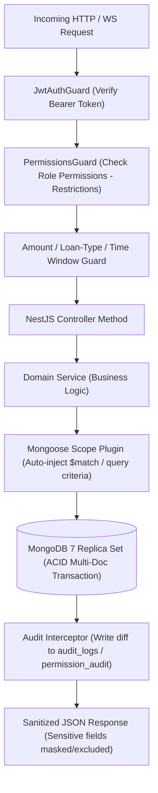

# SHRI AMUDHA SMALL FINANCE - SYSTEM ARCHITECTURE & API CONTRACT FLOW

## 1. System Overview

Shri Amudha Small Finance is an enterprise-grade Loan Management System (LMS) specifically tailored for micro-finance, daily/weekly collection, personal, vehicle, and gold/silver collateralized lending operations.

The system is strictly partitioned into two independent software deliverables:
1. **`backend/`**: A standalone Node.js NestJS application backed by a MongoDB 7 Replica Set (with native multi-document ACID transactions and change streams), Redis (BullMQ queue & permission cache), MinIO/S3 object storage, and modular integration adapters.
2. **`frontend/`**: An independent client workspace containing:
   - `shared/`: Shared UI design tokens (yellow-white), motion tokens, dynamic form engine, permission evaluator (`usePermissions`, `<Can />`), and generated contract types.
   - `mobile/`: React Native Expo application (Android-first, iOS-ready) with offline SQLite sync, biometric/PIN lock, Bluetooth thermal printer support, and camera/fingerprint scanner integrations.
   - `web/`: React + Vite + Tailwind + shadcn/ui Admin Panel for Super Admins and Managers (Workflow Designer, Form Builder, P&L, Reports).

---

## 2. Independent Project Decoupling & API Contract Flow

Neither `frontend/` nor `backend/` imports source code from each other. Communication occurs exclusively through:
1. **REST API**: Standardized JSON over HTTP/S with cursor-based pagination, strict validation, and OpenAPI 3.0 specification.
2. **WebSocket / SSE**: Real-time event bus for workflow transitions, collection alerts, manager notifications, and permission invalidation.
3. **API Contract Pipeline**:
   - `backend/`: `npm run export:contract` extracts the NestJS Swagger document into `backend/contract/openapi.json` and the complete RBAC permissions catalog and default role-matrix into `backend/contract/permissions.json`.
   - `frontend/`: `npm run sync:contract` fetches or copies these JSON definitions into `frontend/shared/generated/` and generates end-to-end typed API clients and TypeScript permission types.
   - **CI Enforcement**: `infra/ci/contract-check.yml` validates that any API modification on the backend has an exact matching contract in the frontend, preventing silent breaking changes.

```mermaid
flowchart LR
    subgraph Backend ["Backend (NestJS + MongoDB 7 Replica Set)"]
        Controllers["Controllers + @RequirePermission()"]
        OpenAPIGen["Swagger / OpenAPI Generator"]
        PermCatalog["Permission Catalog (Source of Truth)"]
        ContractExport["npm run export:contract"]
        
        Controllers --> OpenAPIGen
        PermCatalog --> ContractExport
        OpenAPIGen --> ContractExport
    end

    subgraph ContractArtifacts ["API Contract Artifacts"]
        OpenAPIJson["backend/contract/openapi.json"]
        PermsJson["backend/contract/permissions.json"]
        ContractExport --> OpenAPIJson
        ContractExport --> PermsJson
    end

    subgraph FrontendSync ["Frontend Contract Sync"]
        SyncScript["npm run sync:contract"]
        GeneratedDir["frontend/shared/generated/"]
        ClientCodegen["openapi-typescript & Permission Typegen"]
        
        OpenAPIJson --> SyncScript
        PermsJson --> SyncScript
        SyncScript --> GeneratedDir
        GeneratedDir --> ClientCodegen
    end

    subgraph ClientApps ["Frontend Applications"]
        MobileApp["Mobile App (React Native Expo)"]
        WebAdmin["Web Admin Panel (React + Vite)"]
        
        ClientCodegen --> MobileApp
        ClientCodegen --> WebAdmin
    end
```

---

## 3. Data Scoping & Multi-Layer Security Architecture

Every query in Shri Amudha Small Finance passes through a central Mongoose Scope Plugin that automatically applies data tenancy and role isolation at the database level:
- **`SUPER_ADMIN`**: Global scope (`ALL`). Access to all branches, routes, customers, loans, and system configuration.
- **`MANAGER`**: Default global or restricted to specific `branchId` / routes.
- **`SALESPERSON`**: Strict resource isolation (`ASSIGNED_ONLY` or `createdBy == userId`).

