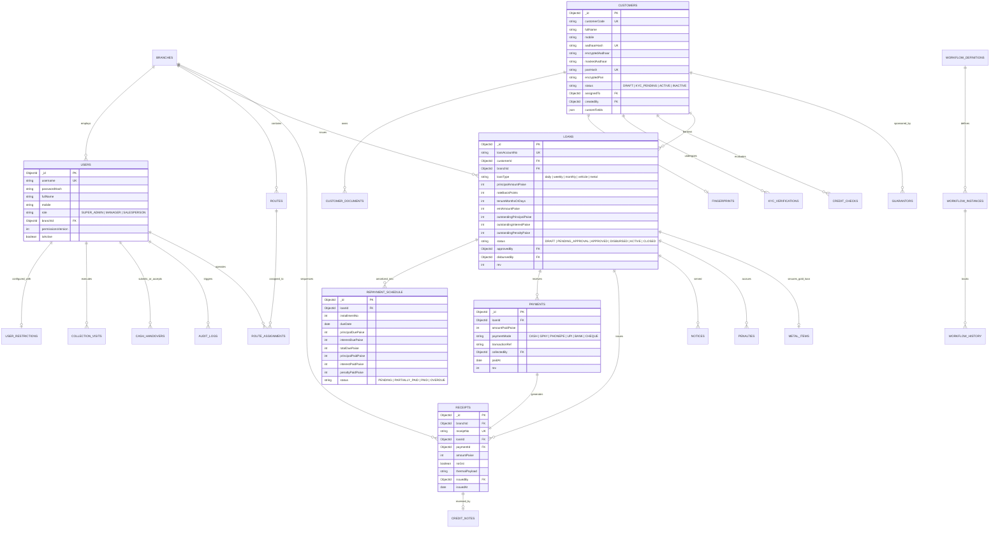

# SHRI AMUDHA SMALL FINANCE - DATABASE COLLECTIONS & ER DIAGRAM

## 1. Mongoose Schema Design Principles
1. **Bounded vs Unbounded**:
   - **Embedded**: Bounded items read alongside parent entity (e.g., guarantor snapshots, document versions array, custom fields object, workflow history records).
   - **Referenced (ObjectId)**: High-velocity unbounded collections (payments, receipts, repayment installments, audit logs, ledger entries, collection visits).
2. **Financial Integrity**:
   - All money is stored as integer paise (`*Paise`), never floats.
   - Sequence generation (receipts, loan account numbers) uses an atomic `counters` collection inside MongoDB transactions.
   - Soft-delete pattern (`deletedAt`, `deletedBy`, `deleteReason`) default filtered by a query plugin.
3. **Security**:
   - AES-256-GCM field-level encryption for Aadhaar, fingerprint templates, raw CIBIL scores, and bank account numbers.
   - Deterministic HMAC-SHA256 hashes (`aadhaarHash`, `panHash`) with unique partial indexes for duplicate detection.

---

## 2. Mermaid Entity-Relationship Diagram

