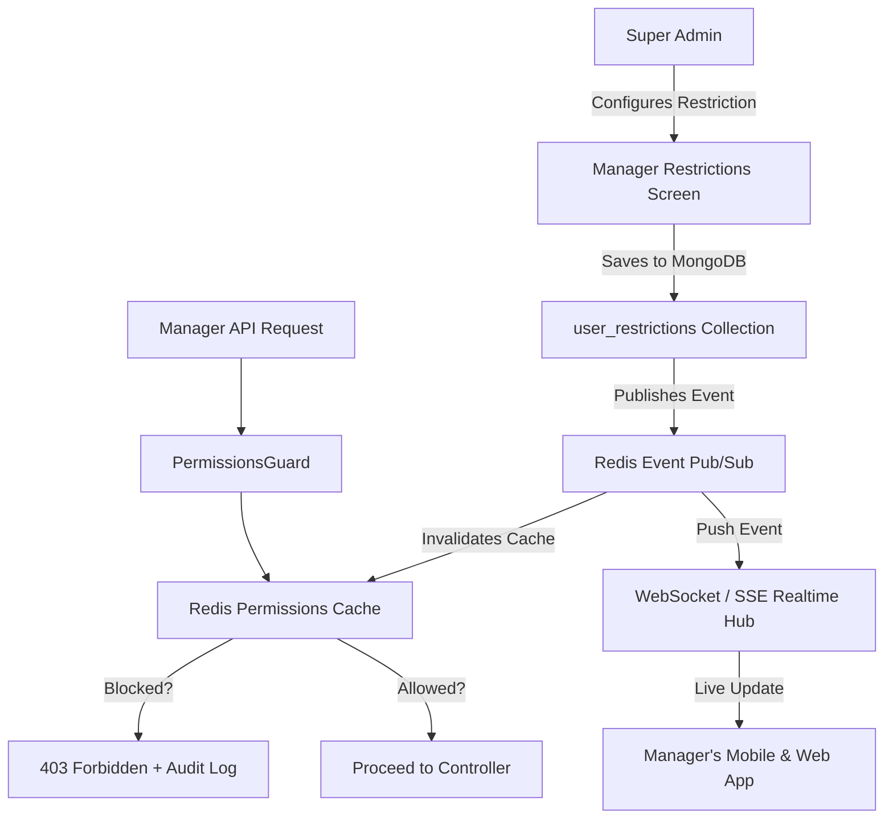

# SHRI AMUDHA SMALL FINANCE - MANAGER RESTRICTIONS ENGINE

## 1. Engine Overview

While Managers have broad default authority to run day-to-day branch operations, the Super Admin can place targeted, fine-grained restrictions on individual managers without modifying the underlying `MANAGER` role definition.

---

## 2. Restriction Types & Evaluation Rules

| Restriction Type | Schema Configuration | Guard Evaluation Logic |
|---|---|---|
| **Module Block** | `blockedModules: string[]` (e.g. `['pnl', 'expenses', 'reports']`) | Request URL / module key checked against list. Complete module hidden in UI. |
| **Action Block** | `blockedActions: string[]` (e.g. `['receipts:cancel', 'customers:delete']`) | Action verb checked. Returns 403; UI shows disabled state with lock icon. |
| **Loan-Type Block**| `blockedLoanTypes: string[]` (e.g. `['metal']`) | Blocks creating, approving, or disbursing loans of that specific product type. |
| **Amount Ceiling**| `maxApprovalAmountPaise: number` (e.g. `10000000` = ₹1,00,000) | Approvals above this threshold automatically route to Super Admin. |
| **Branch Scope** | `allowedBranchIds: ObjectId[]` | Overrides default global scope; query automatically injects `branchId: { $in: ... }`. |
| **Field Block** | `blockedFields: string[]` (e.g. `['cibilRawScore', 'bankAccountNumber']`)| Response serializer strips fields before JSON serialization. |
| **Working Hours** | `workingHours: { start: string, end: string, days: number[] }` | Rejects mutation attempts outside business hours with a descriptive message. |

---

## 3. Pre-Configured Presets

1. **"No P&L and Expenses"**:
   - `blockedModules`: `['pnl', 'expenses']`
   - Intended for branch managers who handle lending and collections but should not view business net margins or operational overheads.
2. **"Operations Only (No Finance)"**:
   - `blockedModules`: `['pnl', 'expenses', 'reports', 'rates']`
   - `blockedActions`: `['receipts:cancel', 'loans:override']`
3. **"Junior Manager (Capped Approval)"**:
   - `maxApprovalAmountPaise`: `5000000` (₹50,000 limit)
   - `blockedLoanTypes`: `['metal']` (No gold/silver collateral approval)
4. **"View-Only Audit"**:
   - `blockedActions`: `['*:create', '*:update', '*:delete', '*:approve', '*:disburse']`

---

## 4. Lifecycle & Expiry

Restrictions can include an optional `expiresAt` ISO timestamp.
- **Evaluation Time**: The `PermissionsGuard` compares `Date.now() < restriction.expiresAt`.
- **Database Cleanup**: A MongoDB TTL index on `expiresAt` automatically evicts expired records.
- **Audit**: Every restriction assignment or removal logs `assignedBy`, `reason`, `oldValues`, and `newValues` into `permission_audit`.
