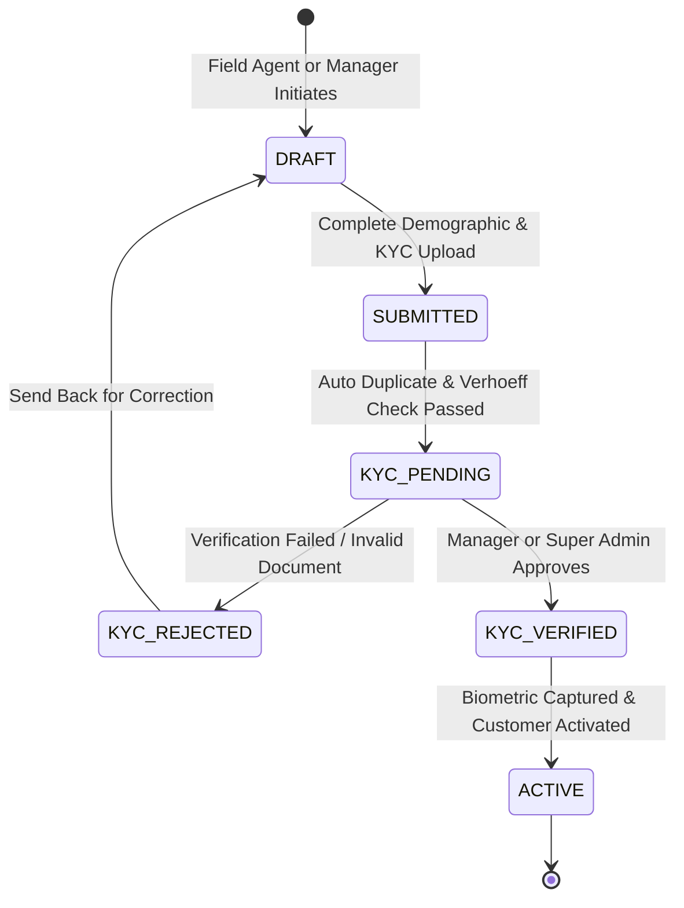
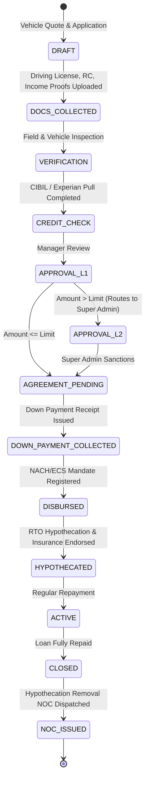
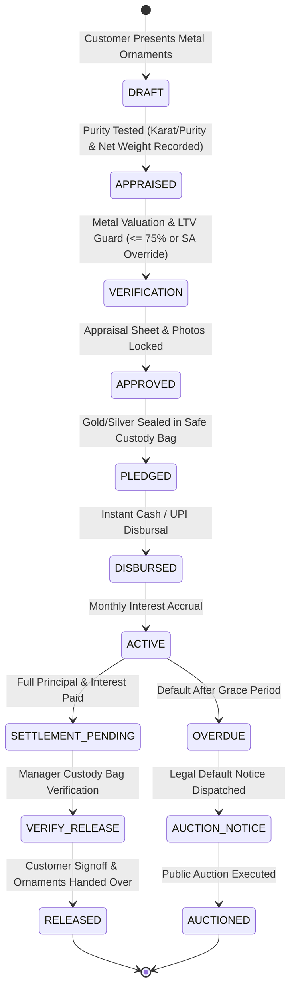
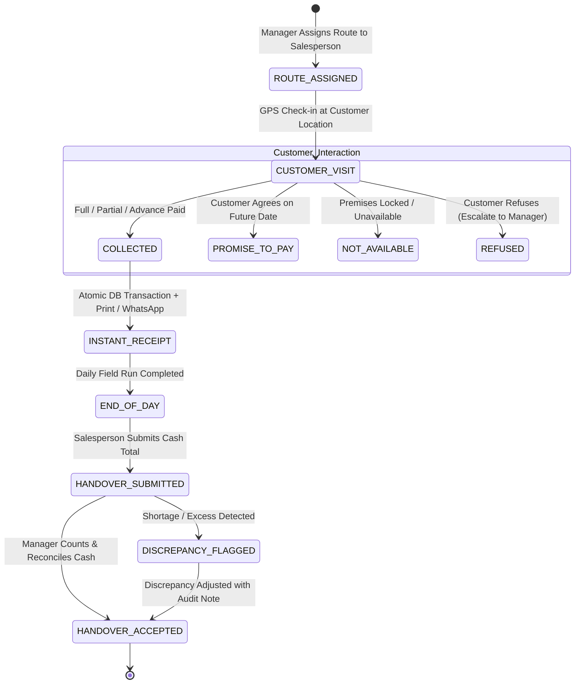
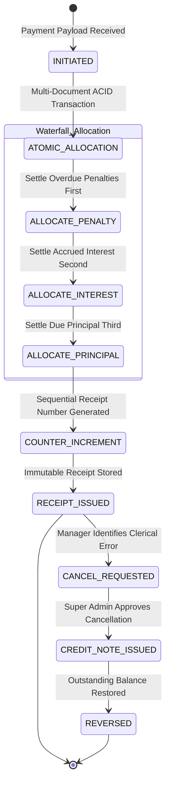

# SHRI AMUDHA SMALL FINANCE - DEFAULT WORKFLOWS (MERMAID STATE DIAGRAMS)

## 1. Customer Onboarding Workflow (`CUSTOMER_ONBOARDING`)

---

## 2. Unsecured Loans Workflow (`LOAN_DAILY`, `LOAN_WEEKLY`, `LOAN_MONTHLY`)

```mermaid
stateDiagram-v2
    [*] --> DRAFT: Created by Manager or Super Admin
    DRAFT --> PENDING_VERIFICATION: Documents & Guarantor Attached
    PENDING_VERIFICATION --> PENDING_APPROVAL: Field Verification Verified
    PENDING_APPROVAL --> REJECTED: Ineligible / High Risk
    REJECTED --> DRAFT: Re-work Application
    PENDING_APPROVAL --> APPROVED: Approved (Manager <= Ceiling; Super Admin > Ceiling)
    APPROVED --> DISBURSED: Payment Made, Agreement Signed, Schedule Generated
    DISBURSED --> ACTIVE: First Due Date Reached
    ACTIVE --> OVERDUE: Grace Days Expired (Cron Job)
    OVERDUE --> ACTIVE: Installment Recovered
    ACTIVE --> CLOSED: All Installments Cleared
    ACTIVE --> FORECLOSED: Early Pre-closure Settlement
    OVERDUE --> WRITTEN_OFF: Bad Debt Approved by Super Admin
    CLOSED --> [*]
    FORECLOSED --> [*]
    WRITTEN_OFF --> [*]
```

---

## 3. Vehicle Loan Workflow (`LOAN_TWO_WHEELER`, `LOAN_FOUR_WHEELER`)

---

## 4. Gold & Silver Collateral Loan Workflow (`LOAN_METAL`)

---

## 5. Field Collection & Cash Handover Workflow (`COLLECTION_VISIT` & `CASH_HANDOVER`)

---

## 6. Payment Allocation & Sequential Receipt Workflow (`PAYMENT`)

